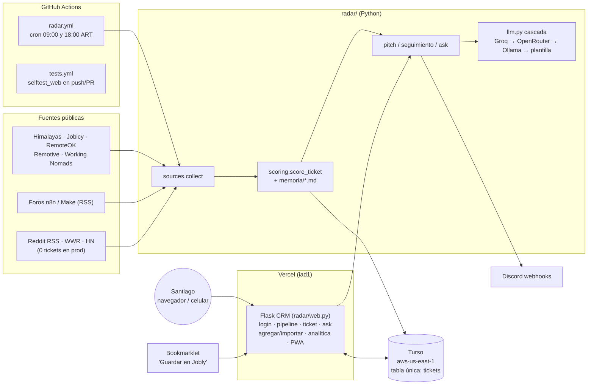
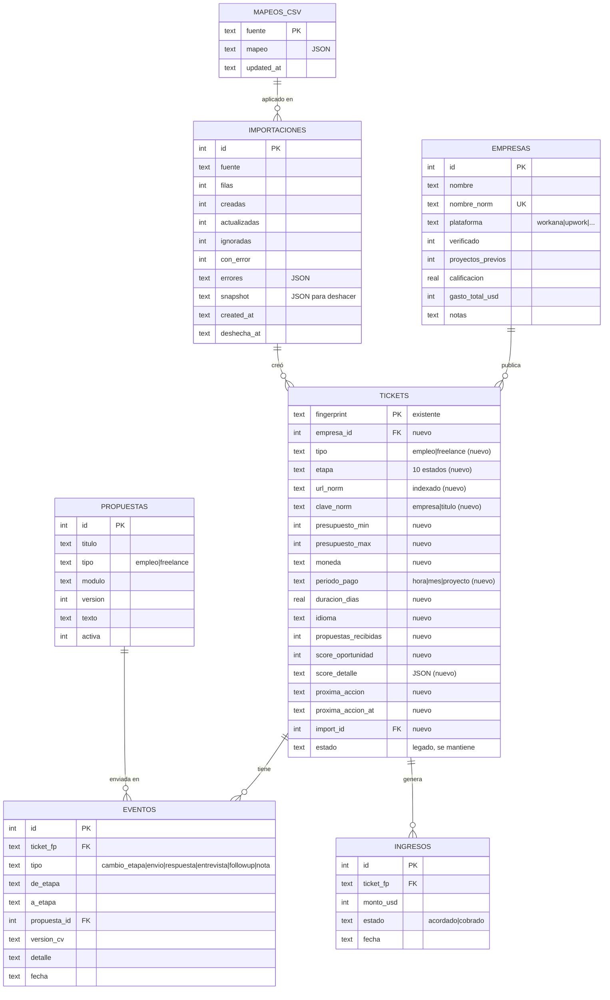

# Auditoría + roadmap de Jobly

> Fecha: 19/10/2026 · Alcance: repo `santiagomalak/Jobly` (`main` @ `0d2f415` + cambios sin commitear), deploy en Vercel (`jobly-ten-blond.vercel.app`), base Turso de producción (**solo lectura**: consultas agregadas, no se escribió nada).
> No se modificó código. Este archivo es el único cambio y no está commiteado.

---

## 0. Resumen ejecutivo

**Lo técnico está sano y lo que frena la meta es otra cosa.** Jobly funciona en producción: cron 2 veces por día, CRM con login, pitch con IA, seguimientos, analítica, tests en CI, sin secretos en el historial (gitleaks: 17 commits, 0 hallazgos). Pero los datos reales de producción muestran esto:

| Métrica (prod, 19/10) | Valor |
|---|---|
| Vacantes relevadas | **1.074** (27/09 → 18/10) |
| Pasaron el filtro | **22** (2 %) |
| Postulaciones registradas | **11**, todas del **04–05/10**: hace 14 días que no se registra ninguna |
| Respuestas | **0** de 11 |
| Fuentes con 0 tickets en toda la historia | Reddit (4 subs), We Work Remotely (2), Hacker News |
| De dónde salieron las 11 postulaciones | 10 cargadas a mano por CSV, 1 del foro de n8n |

Con 12 días hasta fin de mes, **ninguna feature nueva genera USD 900 por sí sola: los genera postular**. Las fuentes automáticas traen sobre todo empleo y casi nada de freelance de 1–3 días. El volumen de freelance está en Workana/Upwork/etc., que es justo lo que querés traer con Claude in Chrome. Por eso el roadmap pone el **importador de CSV + score + vista "Hoy"** en un Sprint 1 recortado a **~2 días de desarrollo**, para que el resto del tiempo sea postular.

Cuenta honesta: con un ticket promedio de USD 250 y un cierre en frío de ~5 % (tu tasa real hoy es 0/11, y en `memoria/05_pricing_y_limites.md` suponés 20 %, que es optimista para propuestas en frío), necesitás **~72 propuestas** para llegar a USD 900, o sea **~6 por día** desde hoy. El copiloto (S2) va a recalcular este número con tus tasas reales.

**Los 3 hallazgos más importantes:**
1. 🔴 **Preview usa la base de producción.** `TURSO_DATABASE_URL`/`TURSO_AUTH_TOKEN` (y `JOBLY_PASSWORD`) están cargadas en *Production y Preview*. El primer PR que pidas va a generar un preview deploy que lee y escribe tus datos reales. Hay que separarlas **antes** de abrir cualquier PR.
2. 🟠 **El modelo de datos no es un CRM todavía**: una sola tabla `tickets` mezcla vacante y postulación, sin empresas, sin historial de estados, sin próxima acción, sin campos freelance (moneda, período de pago, cliente verificado). Además, marcar "perdido" desde "nuevo" lo cuenta como postulación enviada (ya pasó en prod).
3. 🟠 **Latencia y timeouts contra Turso**: cada consulta abre una conexión HTTPS nueva (~1 s desde Argentina). La home hace 4 en serie (4,6 s medidos en caliente desde local) y el import de postulaciones hace ~4 viajes por fila: con 500 filas supera los 60 s de `maxDuration`.

---

## Fase 1 — Reconocimiento

### 1.1 Stack real (lo que el pedido suponía y no existe)

| Supuesto del pedido | Realidad |
|---|---|
| Next.js, `next.config`, React | **No existe.** Es **Python 3.12 + Flask 3** con plantillas Jinja server-side y JS vanilla. |
| Supabase / RLS | **No existe.** Base **Turso (libSQL/SQLite)** por HTTP (`radar/db.py`), SQLite local como fallback. No hay RLS: app de un solo usuario detrás de contraseña. |
| `vercel.json` complejo | 6 líneas: solo `maxDuration: 60` para `app.py` (`vercel.json:4`). Framework preset Flask, función en **iad1**, bundle de 9,85 MB, Node 24 en el proyecto (irrelevante). |
| Tests | Sin pytest: 2 scripts de autotest (`scripts/selftest.py`, `scripts/selftest_web.py`). **Pasan** (verificado hoy). |
| Lint / tipado | No hay linter ni mypy configurados. Hay type hints en casi todo el código. |

Dependencias (`requirements.txt`): `requests`, `feedparser`, `PyYAML`, `python-dotenv`, `flask`. Sin ORM ni drivers nativos.

### 1.2 Arquitectura



### 1.3 Modelo de datos actual

Una sola tabla, `tickets` (`radar/store.py:14-37`), con columnas agregadas en caliente al iniciar (`radar/store.py:40-46`, `:94-98`):

| Columna | Uso |
|---|---|
| `fingerprint` PK | `sha256(título normalizado + "|" + url sin query)[:32]` (`radar/models.py:41-46`) |
| `source, title, url, module` | origen y clasificación (AUTOMATION/DATA/WEB/SCRAPING/BOTS) |
| `score, verdict, budget_usd` | resultado del scoring; `budget_usd` = extremo **bajo** estimado del texto |
| `pitch, engine` | borrador de propuesta y qué LLM lo generó |
| `payload` | JSON con todo el `Ticket` (descripción, tags `tipo:`/`ubicacion:`/`seniority:`, razones) |
| `seen_at, notified` | alta y aviso a Discord |
| `estado, estado_at` | `nuevo/postulado/respondido/ganado/perdido`; **solo la fecha del último cambio** |
| `postulado_at, seguimientos` | primer cambio de estado y follow-ups hechos (tope 2) |
| `notas` | texto libre (4.000 caracteres) |
| `costo_usd` | **existe en prod, pero el código que lo usa está sin commitear** (ver H-05) |

Índices: `seen_at`, `estado`. No hay entidades de empresa/cliente, eventos, propuestas, importaciones ni ingresos.

### 1.4 Inventario de features

| Feature | Estado | Evidencia |
|---|---|---|
| Cron de recolección + scoring + pitch + Discord | ✅ | 47 tickets nuevos/día en las últimas 48 h |
| Fuentes Himalayas, Jobicy, RemoteOK, Remotive, Working Nomads, foros n8n/Make | ✅ | 1.074 tickets en prod |
| Reddit (RSS) | ❌ | 0 tickets `reddit-*` en toda la base. Probable bloqueo de IPs de GitHub Actions (lo dejaste como "no verificado" el 05/10) |
| We Work Remotely, Hacker News | ⚠️ | 0 tickets en prod, sin error visible en la base |
| Login + falla cerrada sin contraseña/Turso | ✅ | `radar/web.py:98-114`, verificado en vivo (302 → `/login`) |
| Pipeline por estado (tabs) + KPIs | ✅ | `radar/templates/index.html` |
| Detalle de ticket: pitch, encaje con perfil, notas, estado | ✅ | `radar/templates/ticket.html` |
| Asistente "Preguntar" (formularios) | ✅ | `radar/ask.py`, `/api/ask` |
| Carga manual + bookmarklet | ✅ | `radar/templates/agregar.html` |
| Import de vacantes por CSV pegado | ⚠️ | Solo 4 columnas (`url,title,description,budget`), sin preview, sin mapeo, sin reporte por fila, sin deshacer (`radar/web.py:326-351`) |
| Registrar postulaciones por CSV | ⚠️ | Funciona con pocas filas; con muchas, timeout (H-04) |
| Seguimientos (48 h / 6 días, máx. 2) | ✅ | Manual: aparecen en un tab, no hay recordatorio activo |
| Meta USD 900 | ⚠️ | Suma el `budget_usd` **estimado** de los "ganados", no lo cobrado (`radar/store.py:242`) |
| Costos/neto por proyecto | ⚠️ | Hecho, sin commitear ni desplegar |
| Analítica por módulo y fuente + ritmo semanal | ✅ | `/analitica` |
| PWA instalable | ✅ | manifest + íconos |
| Empresas, timeline, próxima acción, kanban, búsqueda/filtros, biblioteca de propuestas, pipeline ponderado, modo demo | 💡 | No existen |

### 1.5 Deploy

- **Integración Git ↔ Vercel activa**: cada push a `main` despliega (alias `jobly-git-main-…`). El último deploy (07/10 19:19) es el commit `0d2f415`. **Nunca hubo preview deploys**: no hubo ramas ni PRs.
- **Build**: OK (12 s). No hay build step (Flask sin bundling).
- **Env vars** (solo nombres): `JOBLY_PASSWORD`, `TURSO_DATABASE_URL`, `TURSO_AUTH_TOKEN`, `GROQ_*`, `OPENROUTER_*`, `OLLAMA_*`, `LLM_TIMEOUT`, `LLM_MAX_WAIT`, `JOBLY_URL`, `DISCORD_WEBHOOK_*` (3), `REDDIT_*` (3). **Todas en Production *y* Preview.**
  - Requeridas por la web: `JOBLY_PASSWORD`, `TURSO_*`; recomendadas: `GROQ_API_KEY`, `LLM_*`. **Falta `JOBLY_SECRET_KEY`** (opcional pero recomendada, H-08).
  - Sobran en Vercel (la web no las usa): `DISCORD_WEBHOOK_*`, `REDDIT_*`, `OLLAMA_*`. Son secretos expuestos de más.
- **Dominio**: solo `*.vercel.app` (sin dominio propio).
- **Logs**: en la ventana disponible solo están mis 3 requests de hoy (200/302/200). No hay errores visibles, pero el plan Hobby guarda poco historial, así que esto no prueba que no los haya.
- **Latencia**: `/login` TTFB 0,5 s. Home autenticada medida localmente contra Turso: 6,9 s en frío, 4,6 s en caliente. Desde iad1 (misma región que Turso) va a ser menor, pero mantiene el patrón de 1 conexión TLS por consulta.

### 1.6 Calidad

- **Tests**: `selftest_web.py` (app, Turso mockeado, store, scoring) corre en CI en push/PR (`.github/workflows/tests.yml:18`). `selftest.py` **no corre en CI**. En Windows ambos terminan en `UnicodeEncodeError` al imprimir emojis si no se define `PYTHONIOENCODING=utf-8`. Los asserts pasan, pero el exit code es 1.
- **Lint/format**: no hay.
- **README**: técnico y al día con las fuentes, pero orientado a "radar + Discord". Sin capturas, sin link al deploy y sin la arquitectura web. No sirve como pieza de portfolio.
- **Código muerto/legado**: `n8n/*.json` y `scripts/ingest_one.py` (solo los referencian docs). `docs/FASE2_discord.md` está desactualizado respecto del CRM web.
- **Trabajo sin commitear en `main`**: 10 archivos (costos, cambios en `sources.py`, tests). Además, `ignorado-usa-turso` (SQLite de 20 KB suelto en la raíz, sin trackear).

---

## Fase 2 — Hallazgos

Severidad: 🔴 Crítico / 🟠 Alto / 🟡 Medio / 🟢 Mejora · Esfuerzo: S (<2 h) / M (medio día) / L (1+ día)

| ID | Área | Sev. | Archivo:línea | Problema | Solución | Esf. |
|---|---|---|---|---|---|---|
| H-01 | Deploy/Seguridad | 🔴 | Vercel env (Preview) | Los previews comparten `TURSO_*` y `JOBLY_PASSWORD` con prod: un PR escribiría y migraría la base real | Crear base `jobly-preview` (`turso db create`) + token propio; cargarla solo en Preview, con otra contraseña | S |
| H-02 | Datos | 🟠 | `radar/store.py:113-123` | `marcar()` setea `postulado_at` con cualquier estado ≠ nuevo: "perdido" desde "nuevo" (= descartar) cuenta como postulación. En prod hay 1 caso (`n8n-community-jobs`), que infla "enviadas" y la racha | Separar *Descartada* de *Rechazada*; `postulado_at` solo al pasar a Postulada o a una etapa posterior; script de corrección del dato | S |
| H-03 | Performance | 🟠 | `radar/db.py:98` | `requests.post` sin `Session`: handshake TLS en cada consulta (~1 s desde AR). La home hace 4–5 viajes en serie | `requests.Session()` reutilizada + método `batch()` que mande las 4 consultas de la home en 1 pipeline | S |
| H-04 | Vercel | 🟠 | `radar/web.py:354-385` (`:371`, `:381`) | Import de postulaciones: `get_by_url` + `save` + `marcar` + `set_notas` por fila = ~4 viajes HTTP/fila. 500 filas (`_MAX_IMPORT`, `:34`) ≫ 60 s → timeout a mitad, con un lote a medias | Parseo en cliente, chunks de ≤100 filas, 1 pipeline por chunk con `INSERT … ON CONFLICT` | M |
| H-05 | Proceso | 🟠 | working tree de `main` | 10 archivos sin commitear (costos). La columna `costo_usd` **ya existe en prod**: un `Store()` local con `.env` de prod la migró, pero el código que la usa no está desplegado | Rama `chore/wip-costos` → PR → merge. Regla: el `.env` local apunta a `jobly-preview`, no a prod | S |
| H-06 | Datos | 🟠 | `radar/store.py:14-37` | Tabla única: no modela Empresa, Postulación, Eventos ni Resultado. Sin historial (solo `estado_at` del último cambio), sin próxima acción y sin distinción empleo/freelance (se infiere de tags en el JSON `payload`) | Migración 0001 (ver §4.2): columnas freelance en `tickets` + tablas `empresas`, `eventos`, `propuestas`, `importaciones`, `ingresos` | L |
| H-07 | Datos | 🟠 | `radar/store.py:240-242` | La meta suma `budget_usd` **estimado** (extremo bajo del rango, o tarifa/h × 12) de lo ganado, filtrado por mes UTC | Tabla `ingresos` con monto acordado/cobrado real y fecha; mes en hora ART | S |
| H-08 | Seguridad | 🟡 | `radar/web.py:68-70`, `:147-158` | Login sin rate limit real: `sleep(0.8)` por intento, paralelizable entre instancias serverless. Sin `JOBLY_SECRET_KEY`, la clave de sesión sale de la contraseña con salt fijo | Contador de intentos por IP en Turso (bloqueo 15 min tras 10 fallos) o regla de rate limit del Firewall de Vercel; setear `JOBLY_SECRET_KEY` aleatoria | S |
| H-09 | Datos | 🟡 | `radar/models.py:41-46`, `radar/store.py:180` | Dedupe por `título|url`: la misma URL con otro título entra duplicada (hay 1 en prod). `get_by_url` sin índice → full scan | Columnas `url_norm` y `clave_norm` (empresa+título) con índice; dedupe por ambas en el import | S |
| H-10 | Datos | 🟡 | `radar/store.py:94-98` | Migraciones = `ALTER TABLE ADD COLUMN` al primer request de cada cold start: sin versión, sin rollback y con 2 viajes extra por cold start | Tabla `schema_migrations` + `migrations/NNNN_*.up.sql`/`.down.sql` + comando `radar migrate`; la web solo verifica la versión | M |
| H-11 | Fuentes | 🟡 | `sources.yaml:40-63` | Reddit (4), WWR (2) y HN activos con **0 tickets históricos**: gastan minutos del cron (Reddit en serie, hasta 120 s de espera) | Registrar por fuente `tickets/errores/última_ok` en una tabla `corridas`; desactivar Reddit en CI si confirma 403 (no evadir: acordado el 05/10) | S |
| H-12 | UX | 🟡 | `radar/templates/index.html` | Lo primero que se ve son 6 KPIs; "qué hago hoy" (seguimientos vencidos, top para postular) está escondido en tabs. Sin búsqueda, filtros ni orden | Vista **Hoy** arriba de todo: seguimientos vencidos + top 10 por score + contador "te faltan N propuestas hoy" | S |
| H-13 | Seguridad/Privacidad | 🟡 | `memoria/09_contexto_personal.md`, `memoria/05_*.md` (trackeados) | El repo privado contiene contexto personal y precios; bloquea hacerlo público como portfolio, y la memoria viaja en el bundle de Vercel | Antes de publicar: mover la memoria real fuera del repo (env/Turso) y dejar `memoria_demo/` ficticia | M |
| H-14 | Seguridad | 🟡 | (futuro) export CSV | Hoy no hay export, así que no hay CSV injection. El importer nuevo debe neutralizar celdas que empiezan con `= + - @ \t \r` al **exportar**, y validar URLs al importar | `sanitizar_celda()` en export + `_url_segura` ya existente (`radar/web.py:37`) | S |
| H-15 | Vercel | 🟢 | Vercel env | `DISCORD_*`, `REDDIT_*` y `OLLAMA_*` cargadas en Vercel sin uso en la web | Borrarlas de Vercel (quedan en GitHub Secrets) | S |
| H-16 | Calidad | 🟢 | `scripts/selftest*.py`, `.github/workflows/tests.yml:18` | `selftest.py` no corre en CI; los emojis rompen el exit code en Windows | Agregar `selftest.py` al CI; `PYTHONIOENCODING=utf-8` o `sys.stdout.reconfigure(encoding="utf-8")` | S |
| H-17 | Calidad | 🟢 | repo | Sin linter | `ruff` en CI (check + format) | S |
| H-18 | Código | 🟢 | `n8n/`, `scripts/ingest_one.py`, `ignorado-usa-turso` | Ningún código Python los referencia (`CLAUDE.md` todavía da los workflows de n8n como funcionales: confirmá si los usás) | Si no se usan, mover a `legacy/`; `ignorado-usa-turso` revisarlo y borrarlo | S |
| H-19 | Datos | 🟢 | `radar/scoring.py:41` | Tarifa por hora × 12 h fijas como presupuesto: subestima contratos mensuales y sobreestima microtareas | Guardar `presupuesto_min/max`, `moneda` y `periodo_pago` reales (importer) y calcular `monto_usd_estimado` aparte | S |

**Lo que está bien y no hay que tocar**: SQL siempre parametrizado; autoescape de Jinja + `safe_url` en hrefs; API POST que exige JSON (CSRF mitigado por el preflight CORS); cookie `HttpOnly`/`SameSite=Lax`/`Secure` en Vercel; cabeceras `nosniff`/`DENY`/`no-referrer`; falla cerrada sin contraseña; historial de git limpio de secretos.

**Vercel Cron**: no lo recomiendo. Hobby permite una ejecución diaria y ya tenés un cron en GitHub Actions que corre 2 veces por día y manda a Discord. Los recordatorios de follow-up se suman a esa misma corrida (`radar run` → mensaje "Hoy: 3 seguimientos vencidos").

**Edge vs Node runtime**: no aplica (Python). Python en Vercel corre en Fluid Compute, y los cold starts son aceptables (healthz 1,9 s en frío). La mejora real es H-03.

**Lighthouse/CWV**: no lo medí. Las páginas útiles requieren login y no tengo la contraseña. El HTML pesa ~32 KB, sin JS de framework ni imágenes: el cuello es el TTFB (H-03), no el render.

---

## Fase 3 — Diseño de funcionalidades

### 3.1 Importador de CSV (Claude in Chrome → Jobly)

**Flujo** (página `/importar`, reemplaza la caja de texto de `agregar.html`):
1. **Drag & drop o pegar** `.csv`/`.tsv`. El parseo se hace **en el navegador** con un parser RFC 4180 propio de ~50 líneas en JS vanilla (sin sumar dependencias, como pide `CLAUDE.md`): UTF-8 con o sin BOM, separador `,` `;` o tab autodetectado. Nada grande viaja de una.
2. **Mapeo de columnas**: auto-match por nombre (español/inglés), con selects editables. El mapeo se guarda por `fuente` en la tabla `mapeos_csv` y se reaplica la próxima vez.
3. **Preview** de 20 filas con validación por fila en el cliente: URL `http(s)`, `tipo` ∈ {empleo, freelance}, números en presupuesto, fechas ISO. Las filas con error se marcan en rojo y **no abortan** el lote.
4. **Dedupe** (servidor): primero por `url_norm` (sin query/fragment/`www`, en minúsculas) y después por `clave_norm` = `slug(empresa)|slug(título)`. Política elegible: **ignorar** (default) o **actualizar** campos vacíos.
5. **Envío por chunks** de 100 filas a `POST /api/importaciones/<id>/chunk`: 1 pipeline Turso por chunk, muy por debajo de 60 s y de 1 MB.
6. **Reporte**: creadas / actualizadas / ignoradas por duplicado / con error (con el motivo por fila), descargable.
7. **Historial + deshacer**: cada fila guarda `import_id`. "Deshacer lote" borra lo **creado** por ese lote (si no se postuló todavía) y revierte lo **actualizado** con un snapshot en `importaciones.snapshot`.
8. **Sanitización**: recorte de longitudes; al exportar, prefijo `'` a celdas que empiezan con `= + - @ \t \r`; URLs validadas con `_url_segura`.

**Esquema estándar v1** (tu base, mejorada; los agregados están marcados con ➕):

```
titulo, empresa_o_cliente, url, fuente, tipo, modalidad, pais, seniority,
presupuesto_min, presupuesto_max, moneda, periodo_pago, duracion_estimada,
stack, requisitos, idioma ➕, cliente_verificado, proyectos_previos_cliente,
calificacion_cliente ➕, gasto_total_cliente_usd ➕, propuestas_recibidas ➕,
fecha_publicacion, fecha_relevamiento, contacto, notas
```

- `idioma` (es|pt|en): pesa en el score (inglés solo lectura).
- `calificacion_cliente` (0–5) y `gasto_total_cliente_usd`: son las señales de calidad de cliente que muestran Upwork/Workana.
- `propuestas_recibidas`: la competencia. Con 50+ propuestas, la probabilidad cae.
- `periodo_pago` ∈ {hora, mes, proyecto}; `modalidad` ∈ {remoto, hibrido, presencial}; `duracion_estimada` en días (número).
- `stack` separado por `|` (no por coma, para no romper el CSV).

### 3.2 Pipeline de postulaciones

Estados nuevos (columna `etapa`, conviviendo con `estado` mientras dura la migración):

`relevada → interesa → postulada → en_proceso → entrevista_negociacion → oferta → ganada | rechazada | descartada | sin_respuesta`

- Cada cambio inserta en `eventos` (`tipo=cambio_etapa`, `de`, `a`, `fecha`). La timeline del ticket se arma con estos eventos más las notas, las propuestas enviadas (con `propuesta_id`/versión de CV) y las respuestas.
- **Próxima acción** (`proxima_accion`, `proxima_accion_at`) en cada postulación; la vista Hoy ordena por esa fecha.
- **Follow-up automático**: al pasar a `postulada` se agenda `proxima_accion_at` según el tipo. Freelance: 48 h y 6 días (tu política en `memoria/06`). Empleo: 7 y 14 días. Pasado el último sin respuesta → `sin_respuesta` automático en el cron. El cron manda a Discord "Hoy: N follow-ups".
- **Biblioteca de propuestas** (`propuestas`): texto, tipo, módulo, versión, veces enviada y respuestas. Desde el ticket: "usar como base" y "guardar esta como plantilla". La tasa de respuesta por propuesta sale de los eventos.

### 3.3 Copiloto de ingresos

**Barra de meta** (arriba en la home):
`confirmado` (ingresos con estado cobrado o acordado del mes) + `ponderado` (Σ monto × prob. de la etapa) vs USD 900, con los días restantes del mes en hora ART.
Probabilidad por etapa (inicial, ajustable): postulada 5 %, en_proceso 20 %, entrevista/negociación 40 %, oferta 70 %, ganada 100 %. Con 10+ casos por etapa se reemplaza por tu tasa real.

**Score de oportunidad 0–100** (determinístico y explicable, se guarda con su desglose):

| Componente | Peso | Cómo se calcula |
|---|---|---|
| Encaje de stack | 25 | `fit.analizar`: tenés / (tenés + faltan) sobre `stack`+`requisitos`+descripción |
| Monto en USD | 20 | Óptimo en USD 150–450 por proyecto; < 120 = 0 (piso duro); empleo: sueldo mensual ≥ USD 900 = máximo |
| Tiempo estimado | 15 | 1–3 días = 15; 4–7 = 8; > 7 o vacío = 4 (empleo: neutro 8) |
| Calidad del cliente | 15 | verificado 5 + proyectos previos (≥ 1: 3, ≥ 5: 5) + calificación ≥ 4,5: 5 |
| Remoto / región | 10 | remoto + worldwide/LATAM/AR = 10; región excluyente = 0 |
| Idioma | 5 | es/pt = 5; inglés escrito = 3; llamadas en inglés exigidas = 0 |
| Seniority | 5 | junior/semi = 5; sin dato = 3; senior/lead = 0 |
| Portfolio | 5 | toca Data + IA/automatización o full stack visible = 5 |
| Competencia | −10…0 | propuestas recibidas: < 10 = 0; 10–30 = −4; > 30 = −10 |

El score actual del radar (`scoring.py`) queda como filtro de entrada del cron y el nuevo se muestra en la UI con un tooltip "por qué".

**"¿Cuántas postulaciones necesito?"**
`propuestas_por_día = (900 − confirmado − ponderado) / (ticket_promedio × tasa_cierre) / días_restantes`
`tasa_cierre` = la real por fuente si hay ≥ 10 envíos; si no, un prior configurable (5 % freelance en frío, 2 % empleo). Se muestra por fuente: "Workana: 4/día · Upwork: 3/día".

**Métricas**: embudo por fuente, tipo (empleo/freelance), módulo y versión de propuesta/CV (enviadas → respuesta → entrevista → ganada), más el tiempo medio hasta la respuesta.

**Gap analysis**: frecuencia de cada tecnología en lo relevado de los últimos 30 días (`fit.TECNOLOGIAS`) contra tu perfil. Top 10 pedidas que no tenés, y top 10 que tenés y conviene destacar.

**Resumen semanal con IA (opcional)**: lo arma un job del cron de GitHub Actions los lunes con las métricas agregadas (no texto crudo de ofertas ni datos de contacto), en una sola llamada. Recomiendo usar primero tu cascada gratis actual (Groq → OpenRouter). Claude API queda como opción con tope duro de tokens por llamada; calculo el costo con la tabla de precios vigente antes de activarlo.

### 3.4 Jobly como portfolio

- **Modo demo**: proyecto Vercel aparte (`jobly-demo`) con base Turso `jobly-demo`, `JOBLY_DEMO=1` (botón "Entrar a la demo" sin contraseña; IA limitada a plantilla o con rate limit), `memoria_demo/` con un perfil ficticio y seed de ~150 vacantes y ~30 postulaciones con timeline creíble. Reset nocturno desde GitHub Actions. Tus datos reales nunca tocan ese deploy.
- **README** nuevo: problema → solución → capturas/GIF → arquitectura (el Mermaid de §1.2) → decisiones técnicas (Turso por HTTP sin drivers, cascada de LLMs gratis, score explicable, falla cerrada) → link a la demo.
- **Features vitrina** (muestran Data + Full Stack + IA):
  1. **Embudo y cohortes** por fuente/versión de propuesta, con gráficos (Data).
  2. **Importador con mapeo, dedupe y deshacer** (ingeniería de datos aplicada).
  3. **Score explicable** + **gap analysis de skills** del mercado relevado (Data + IA).
- **Caso de estudio y post de LinkedIn**: borradores al cierre del Sprint 3, con métricas reales (sin datos de clientes).

---

## Fase 4 — Entregables

### 4.1 Modelo de datos propuesto (ER)



Por qué no separo `vacantes` de `postulaciones` en dos tablas: en tu uso hay a lo sumo 1 postulación por vacante, y separarlas obliga a reescribir todo `store.py`, el cron y las plantillas. Dejo `tickets` como la entidad Vacante+Postulación y agrego `eventos` para el historial. Es una mejora incremental, no una reescritura, como pediste.

### 4.2 Migraciones reversibles

Estrategia **expand → migrar → contract**: la 0001 solo **agrega** (no rompe el código desplegado), el código nuevo lee `etapa` detrás del flag `JOBLY_ETAPAS=1`, y el *contract* (dejar de escribir `estado`) va recién en una 0003, después de una semana estable. Antes de migrar prod: `turso db shell <db> .dump > backup_YYYYMMDD.sql`. Cada migración se prueba primero en `jobly-preview`.

`migrations/0001_crm_base.up.sql`
```sql
CREATE TABLE IF NOT EXISTS schema_migrations (version INTEGER PRIMARY KEY, applied_at TEXT DEFAULT CURRENT_TIMESTAMP);

CREATE TABLE empresas (
  id INTEGER PRIMARY KEY AUTOINCREMENT,
  nombre TEXT NOT NULL, nombre_norm TEXT NOT NULL UNIQUE,
  plataforma TEXT, verificado INTEGER, proyectos_previos INTEGER,
  calificacion REAL, gasto_total_usd INTEGER, notas TEXT DEFAULT ''
);
CREATE TABLE eventos (
  id INTEGER PRIMARY KEY AUTOINCREMENT,
  ticket_fp TEXT NOT NULL REFERENCES tickets(fingerprint) ON DELETE CASCADE,
  tipo TEXT NOT NULL CHECK (tipo IN ('cambio_etapa','envio','respuesta','entrevista','followup','nota')),
  de_etapa TEXT, a_etapa TEXT, propuesta_id INTEGER, version_cv TEXT, detalle TEXT,
  fecha TEXT NOT NULL DEFAULT CURRENT_TIMESTAMP
);
CREATE INDEX idx_eventos_ticket ON eventos(ticket_fp, fecha);
CREATE TABLE propuestas (
  id INTEGER PRIMARY KEY AUTOINCREMENT, titulo TEXT NOT NULL,
  tipo TEXT CHECK (tipo IN ('empleo','freelance')), modulo TEXT,
  version INTEGER DEFAULT 1, texto TEXT NOT NULL, activa INTEGER DEFAULT 1,
  created_at TEXT DEFAULT CURRENT_TIMESTAMP
);
CREATE TABLE ingresos (
  id INTEGER PRIMARY KEY AUTOINCREMENT,
  ticket_fp TEXT REFERENCES tickets(fingerprint) ON DELETE SET NULL,
  monto_usd INTEGER NOT NULL CHECK (monto_usd >= 0),
  estado TEXT NOT NULL CHECK (estado IN ('acordado','cobrado')),
  fecha TEXT NOT NULL
);
CREATE TABLE importaciones (
  id INTEGER PRIMARY KEY AUTOINCREMENT, fuente TEXT NOT NULL,
  filas INTEGER DEFAULT 0, creadas INTEGER DEFAULT 0, actualizadas INTEGER DEFAULT 0,
  ignoradas INTEGER DEFAULT 0, con_error INTEGER DEFAULT 0,
  errores TEXT DEFAULT '[]', snapshot TEXT DEFAULT '[]',
  created_at TEXT DEFAULT CURRENT_TIMESTAMP, deshecha_at TEXT
);
CREATE TABLE mapeos_csv (fuente TEXT PRIMARY KEY, mapeo TEXT NOT NULL, updated_at TEXT DEFAULT CURRENT_TIMESTAMP);

ALTER TABLE tickets ADD COLUMN empresa_id INTEGER REFERENCES empresas(id);
ALTER TABLE tickets ADD COLUMN tipo TEXT;
ALTER TABLE tickets ADD COLUMN etapa TEXT;
ALTER TABLE tickets ADD COLUMN url_norm TEXT;
ALTER TABLE tickets ADD COLUMN clave_norm TEXT;
ALTER TABLE tickets ADD COLUMN presupuesto_min INTEGER;
ALTER TABLE tickets ADD COLUMN presupuesto_max INTEGER;
ALTER TABLE tickets ADD COLUMN moneda TEXT;
ALTER TABLE tickets ADD COLUMN periodo_pago TEXT;
ALTER TABLE tickets ADD COLUMN duracion_dias REAL;
ALTER TABLE tickets ADD COLUMN idioma TEXT;
ALTER TABLE tickets ADD COLUMN propuestas_recibidas INTEGER;
ALTER TABLE tickets ADD COLUMN score_oportunidad INTEGER;
ALTER TABLE tickets ADD COLUMN score_detalle TEXT;
ALTER TABLE tickets ADD COLUMN proxima_accion TEXT;
ALTER TABLE tickets ADD COLUMN proxima_accion_at TEXT;
ALTER TABLE tickets ADD COLUMN import_id INTEGER REFERENCES importaciones(id);

CREATE INDEX idx_tickets_url_norm ON tickets(url_norm);
CREATE INDEX idx_tickets_clave_norm ON tickets(clave_norm);
CREATE INDEX idx_tickets_etapa_accion ON tickets(etapa, proxima_accion_at);
CREATE INDEX idx_tickets_postulado ON tickets(postulado_at);
CREATE INDEX idx_tickets_import ON tickets(import_id);

-- backfill de etapa desde el estado legado (descartes mal contados: H-02)
UPDATE tickets SET etapa = CASE estado
  WHEN 'nuevo' THEN 'relevada' WHEN 'postulado' THEN 'postulada'
  WHEN 'respondido' THEN 'en_proceso' WHEN 'ganado' THEN 'ganada'
  WHEN 'perdido' THEN 'rechazada' END;
UPDATE tickets SET tipo = CASE WHEN payload LIKE '%"tipo:%' THEN 'empleo' ELSE 'freelance' END;
-- url_norm/clave_norm se completan con un script Python (la normalización no entra en SQL)

INSERT INTO schema_migrations(version) VALUES (1);
```

`migrations/0001_crm_base.down.sql`
```sql
DROP INDEX IF EXISTS idx_tickets_import;
DROP INDEX IF EXISTS idx_tickets_postulado;
DROP INDEX IF EXISTS idx_tickets_etapa_accion;
DROP INDEX IF EXISTS idx_tickets_clave_norm;
DROP INDEX IF EXISTS idx_tickets_url_norm;
ALTER TABLE tickets DROP COLUMN import_id;
ALTER TABLE tickets DROP COLUMN proxima_accion_at;
ALTER TABLE tickets DROP COLUMN proxima_accion;
ALTER TABLE tickets DROP COLUMN score_detalle;
ALTER TABLE tickets DROP COLUMN score_oportunidad;
ALTER TABLE tickets DROP COLUMN propuestas_recibidas;
ALTER TABLE tickets DROP COLUMN idioma;
ALTER TABLE tickets DROP COLUMN duracion_dias;
ALTER TABLE tickets DROP COLUMN periodo_pago;
ALTER TABLE tickets DROP COLUMN moneda;
ALTER TABLE tickets DROP COLUMN presupuesto_max;
ALTER TABLE tickets DROP COLUMN presupuesto_min;
ALTER TABLE tickets DROP COLUMN clave_norm;
ALTER TABLE tickets DROP COLUMN url_norm;
ALTER TABLE tickets DROP COLUMN etapa;
ALTER TABLE tickets DROP COLUMN tipo;
ALTER TABLE tickets DROP COLUMN empresa_id;
DROP TABLE IF EXISTS mapeos_csv;
DROP TABLE IF EXISTS importaciones;
DROP TABLE IF EXISTS ingresos;
DROP TABLE IF EXISTS propuestas;
DROP TABLE IF EXISTS eventos;
DROP TABLE IF EXISTS empresas;
DELETE FROM schema_migrations WHERE version = 1;
```

Notas:
- `DROP COLUMN` requiere SQLite ≥ 3.35. libSQL/Turso lo soporta; lo verifico en `jobly-preview` antes de prod.
- Los `REFERENCES` de las columnas agregadas con `ALTER` son documentales: Turso no aplica `PRAGMA foreign_keys` por defecto. La integridad la garantiza el código y las borra el `down`.
- El `down` no se puede correr una vez que el código *contract* (0003) esté desplegado. Para ese momento, la vuelta atrás es el backup.

### 4.3 Roadmap orientado a la meta

Regla para todo: una rama por tarea, un commit por tarea, un PR (que genera preview contra `jobly-preview`), CI verde y merge. Nada se migra en prod sin backup y sin haber pasado por preview.

**Costo fijo agregado: USD 0.** `jobly-preview` y `jobly-demo` entran en el plan gratis de Turso (varias bases por cuenta), y el proyecto demo en Vercel Hobby. La única pieza con costo variable es el resumen con Claude API (3.6, opcional), que se calcula antes de activarlo.

#### Sprint 1 — ~2 días de desarrollo (20–21/10): postular más y mejor desde ya

| # | Tarea | Hallazgo | Esf. | Criterio de aceptación |
|---|---|---|---|---|
| 1.0 | Separar Preview de prod (Turso `jobly-preview` + contraseña propia) y apuntar el `.env` local ahí | H-01, H-05 | S | `vercel env ls` muestra valores distintos por entorno; un preview no altera `count(*)` de prod |
| 1.1 | Commitear el WIP de costos en rama + PR | H-05 | S | `main` limpio; prod muestra "Costos del proyecto" en un ganado |
| 1.2 | `requests.Session` + batch de las consultas de la home | H-03 | S | Home autenticada en prod con TTFB < 1,5 s (medido con curl y la cookie) |
| 1.3 | Runner de migraciones + 0001 (up/down probados en preview) | H-06, H-10 | M | `radar migrate` y `radar migrate --down 1` dejan el esquema idéntico al original (diff de `PRAGMA table_info`) |
| 1.4 | Fix descartar ≠ postular + corrección del dato | H-02 | S | Descartar desde "Pendientes" no cambia "enviadas" ni la racha; el caso de prod corregido |
| 1.5 | Importador CSV v1: parseo en cliente, mapeo recordado, preview, dedupe URL + empresa/título, ignorar/actualizar, chunks de 100, reporte por fila, historial y deshacer | H-04, H-09, H-14 | L | 300 filas con 10 inválidas y 20 duplicadas → 270 creadas, 20 ignoradas, 10 errores con motivo, en < 30 s y sin abortar; "Deshacer" deja `count(*)` como antes; `;` y BOM funcionan |
| 1.6 | Score de oportunidad v1 con desglose | — | M | Cada ticket importado tiene `score_oportunidad` + tooltip "por qué"; tests de 6 casos tipo (un proyecto de USD 300 en 2 días con cliente verificado > 80; un senior en EE. UU. < 30) |
| 1.7 | Vista **Hoy** arriba de la home | H-12 | S | Al abrir se ven, sin hacer clic: follow-ups vencidos, top 10 por score y "te faltan N propuestas hoy" |

En paralelo, desde hoy, sin esperar a nada: postular con lo que ya hay (carga manual + bookmarklet + "Registrar postulaciones").

#### Sprint 2 — semana del 27/10: pipeline completo + meta

| # | Tarea | Esf. | Criterio de aceptación |
|---|---|---|---|
| 2.1 | 10 etapas detrás de `JOBLY_ETAPAS=1` + eventos en cada cambio | M | Cambiar etapa crea un evento; con el flag apagado, la UI vieja funciona igual |
| 2.2 | Timeline por postulación + próxima acción con fecha | M | El ticket muestra los eventos ordenados; la vista Hoy ordena por `proxima_accion_at` |
| 2.3 | Follow-ups automáticos (agenda al postular; `sin_respuesta` al vencer el último) + aviso diario en Discord desde el cron | S | Postular hoy agenda el follow-up a +2 d (freelance) o +7 d (empleo); el cron del día siguiente lo lista en Discord |
| 2.4 | Biblioteca de propuestas con versión y tasa de respuesta | M | "Guardar como plantilla" y "Usar como base" funcionan; cada envío registra `propuesta_id` |
| 2.5 | Ingresos reales + barra de meta (confirmado + ponderado + días restantes, en ART) | S | Cargar un ingreso cobrado de USD 300 mueve la barra a 33 % confirmado; el ponderado coincide con un cálculo manual |
| 2.6 | Calculadora "propuestas por día" por fuente | S | Con datos de prueba conocidos, el número coincide con la fórmula de §3.3 |
| 2.7 | Rate limit de login + `JOBLY_SECRET_KEY` + limpieza de env vars | S | El intento 11 desde la misma IP devuelve 429 por 15 min |

#### Sprint 3 — noviembre: vitrina

| # | Tarea | Esf. | Criterio de aceptación |
|---|---|---|---|
| 3.1 | Dashboard analítico: embudo por fuente/tipo/versión, tiempo a respuesta, gap analysis | L | Gráficos con datos reales; tasas solo con n ≥ 5 (como hoy) |
| 3.2 | Modo demo (proyecto y base aparte, seed, `memoria_demo/`, reset nocturno) | L | Un tercero entra sin contraseña y no puede ver ningún dato real; el reset nocturno restaura el seed |
| 3.3 | Separar la memoria personal del repo (requisito para hacerlo público) | M | `git grep` sin datos personales; prod sigue generando pitches |
| 3.4 | README de portfolio + capturas/GIF + caso de estudio + post de LinkedIn | M | README con link a la demo, arquitectura y 3 capturas; borradores entregados |
| 3.5 | Calidad: `ruff` + `selftest.py` en CI + fix de encoding + borrar legado | S | CI corre ambos tests y lint; pasa en Windows sin `PYTHONIOENCODING` |
| 3.6 | (Opcional) Resumen semanal con IA | S | Llega los lunes a Discord; usa solo métricas agregadas; costo calculado antes de activarlo |

### 4.4 Prompt para Claude in Chrome

> **Límite ético/legal (lo digo derecho, como siempre):** este prompt trabaja **solo sobre páginas que abriste vos y estás viendo**. No pagina solo, no hace login, no postula ni manda mensajes. Upwork y Workana prohíben en sus términos la recolección automatizada masiva, y **Freelancer.com prohíbe cualquier acceso automatizado** (ya lo descartaste por su §33): ahí no lo uses. Un asistente que pasa a CSV lo que vos tenés abierto es una zona gris de bajo riesgo; un crawler no lo es, y podría costarte la cuenta justo en la plataforma donde querés cobrar.

```
Sos mi asistente de relevamiento de oportunidades laborales. Trabajá SOLO sobre las pestañas que yo tengo abiertas ahora mismo (búsquedas o avisos de Workana, Upwork, RemoteOK, We Work Remotely, LinkedIn Jobs, Get on Board, etc.). No hagas clic en "siguiente página", no inicies sesión, no postules, no envíes mensajes y no abras más de 30 avisos. Si una pestaña es de freelancer.com, salteala.

Para cada aviso visible, extraé los datos y devolveme UN SOLO bloque de código CSV con exactamente este encabezado y este orden de columnas:

titulo,empresa_o_cliente,url,fuente,tipo,modalidad,pais,seniority,presupuesto_min,presupuesto_max,moneda,periodo_pago,duracion_estimada,stack,requisitos,idioma,cliente_verificado,proyectos_previos_cliente,calificacion_cliente,gasto_total_cliente_usd,propuestas_recibidas,fecha_publicacion,fecha_relevamiento,contacto,notas

Reglas de formato (obligatorias):
- Separador coma. Encerrá TODOS los campos de texto entre comillas dobles; si un texto contiene comillas, duplicalas (""). Sin saltos de línea dentro de un campo: reemplazalos por " / ".
- Si un dato no aparece en la página, dejá el campo VACÍO. Nunca inventes, estimes ni completes con suposiciones.
- url: el link directo al aviso (no al listado), sin parámetros de tracking (sacá todo desde "?" si son utm_ o ref).
- fuente: el nombre del sitio en minúsculas (workana, upwork, remoteok, weworkremotely, linkedin, getonboard, otro).
- tipo: "freelance" si es un proyecto o contrato por tarea; "empleo" si es un puesto en relación de dependencia o contrato mensual de tiempo completo.
- modalidad: remoto | hibrido | presencial.
- pais: el país o región exigida para el candidato tal como figura (ej. "Worldwide", "LATAM", "USA only"). Vacío si no dice.
- seniority: junior | semi | senior | lead, solo si el aviso lo dice.
- presupuesto_min / presupuesto_max: números enteros sin símbolos ni separadores de miles (1500, no "1.500" ni "$1,500"). Si hay un solo monto, ponelo en ambos.
- moneda: código ISO (USD, EUR, BRL, ARS...).
- periodo_pago: hora | mes | proyecto. Sueldo anual: convertilo a mensual (÷12), poné "mes" y aclará "anual convertido" en notas.
- duracion_estimada: número de días (ej. "1 a 3 semanas" → 14 y el texto original en notas). Vacío si no dice.
- stack: tecnologías mencionadas, separadas por " | " (barra vertical), en minúsculas.
- requisitos: máximo 300 caracteres con los requisitos clave (años de experiencia, idiomas, horario).
- idioma: idioma en que está escrito el aviso: es | pt | en. Si exige llamadas o inglés fluido hablado, agregá "requiere inglés hablado" en notas.
- cliente_verificado: si | no | vacío. Solo si la plataforma lo muestra (ej. "Payment verified" en Upwork).
- proyectos_previos_cliente, calificacion_cliente (0 a 5), gasto_total_cliente_usd, propuestas_recibidas: números, solo si la plataforma los muestra (ej. "Proposals: 20 to 50" → 20).
- fecha_publicacion: AAAA-MM-DD. Si dice "hace 3 horas", calculala a partir de la fecha de hoy.
- fecha_relevamiento: la fecha de hoy, AAAA-MM-DD.
- contacto: solo si el aviso publica un email o un nombre de reclutador. Nada más.
- notas: cualquier aclaración útil, máximo 200 caracteres.
- Ningún campo puede empezar con =, +, - o @: si pasa, anteponé un apóstrofo (').

Al final, fuera del bloque CSV, decime en una línea cuántos avisos procesaste y cuáles salteaste y por qué.
```

Ejemplo de salida esperada (2 filas):

```csv
titulo,empresa_o_cliente,url,fuente,tipo,modalidad,pais,seniority,presupuesto_min,presupuesto_max,moneda,periodo_pago,duracion_estimada,stack,requisitos,idioma,cliente_verificado,proyectos_previos_cliente,calificacion_cliente,gasto_total_cliente_usd,propuestas_recibidas,fecha_publicacion,fecha_relevamiento,contacto,notas
"Automatizar reportes de ventas con n8n y Google Sheets","Cliente sin nombre","https://www.workana.com/job/automatizar-reportes-n8n","workana","freelance","remoto","","",150,300,"USD","proyecto",5,"n8n | google sheets | api rest","Experiencia previa con n8n","es","si",4,4.8,,12,2026-10-18,2026-10-19,"",""
"Data Analyst (Power BI)","Acme Analytics","https://remoteok.com/remote-jobs/123456","remoteok","empleo","remoto","LATAM","junior",1200,1500,"USD","mes",,"power bi | sql | excel","1+ años con Power BI; inglés escrito","en","",,,,,2026-10-17,2026-10-19,"","requiere inglés hablado"
```

### 4.5 Preguntas antes de implementar

Te dejo solo las que cambian lo que hago. Cada una trae mi recomendación: si me respondés "ok a todo", voy con eso.

1. **Base de preview**: ¿creo `jobly-preview` en Turso con tu CLI y cargo sus credenciales en Vercel Preview, o preferís hacerlo vos? → *Recomiendo que lo haga yo; solo te pido confirmar que tenés `turso` logueado.* Es lo único que bloquea el flujo de PRs.
2. **WIP sin commitear (costos)**: ¿lo subo tal cual en una rama + PR? → *Sí.*
3. **Ingresos**: ¿la meta cuenta lo **cobrado** o también lo **acordado**? → *Confirmado = acordado + cobrado, con el cobrado marcado aparte.*
4. **Follow-ups**: ¿mantengo tu política de `memoria/06` (48 h y 6 días) para freelance y uso 7 y 14 días para empleo, o preferís 5–7 días para todo como dice el pedido? → *48 h/6 d freelance, 7/14 d empleo.*
5. **Plataformas**: ¿en cuáles tenés cuenta activa y con propuestas disponibles hoy (Workana, Upwork, otra)? Esto define la fuente por defecto del importador y los priors de conversión.
6. **Portfolio**: ¿el objetivo es hacer **público** el repo, o alcanza con la demo pública y el repo privado? → *Demo pública + repo público recién en Sprint 3, después de sacar la memoria personal (H-13).*

---

*Estoy parado acá, como pediste: no toco código hasta que apruebes el plan (o lo ajustes).*
